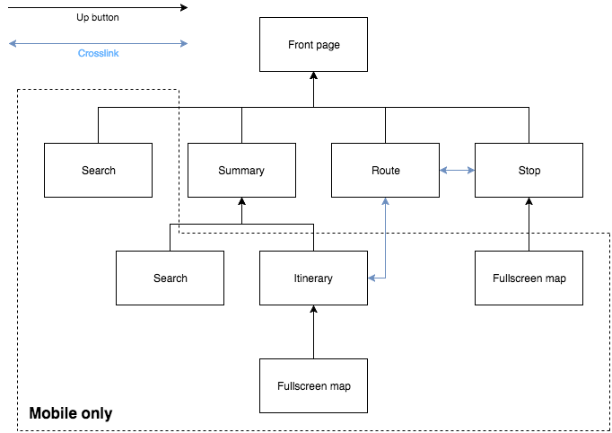

# Application navigation and hierarchy

Navigation in digitransit-ui should, whenever possible, adhere to the [Material Design guidelines](https://material.io/guidelines/patterns/navigation.html#navigation-up-back-buttons). Read that document first to get an idea of the concept and terminology.

## Itinerary search lifecycle

Changing itinerary search inputs invalidates pending requests from the previous
search. Late results and errors must not update the view or trigger further
query iterations. This also applies to alternative plans and earlier/later
requests, and pending results are ignored when the itinerary page unmounts.

Unmounting the itinerary page always stops its MQTT client, including subscriptions
started by the navigator, regardless of whether itinerary vehicles are displayed.

## Language in URLs

The URL path is the only source of the page language; there is no language cookie and no
`Accept-Language` negotiation.

- The default language (`config.defaultLanguage`) is served without a prefix: `/reitti/A/B`.
- Other languages in `config.availableLanguages` keep a `/{lang}/` prefix on every page:
  `/en/reitti/A/B`.
- `/{defaultLanguage}/…` gets a 301 to the same path without the prefix (`/fi/x` → `/x`). With
  `redirectReittiopasParams`, old reittiopas prefixes that aren't available (e.g. `/ru/`) get a 302.
- Paths with repeated slashes or backslashes get a 301 to single slashes (`//sv/x` → `/sv/x`,
  `server/middleware/slashMiddleware.js`) before anything else runs.

### Server

`server/middleware/languageMiddleware.js` reads the prefix with `getLanguageFromPath`
(`utils/shared/languageUtils.js`) and sets `res.locals.language`, which `shell.js` renders as
`<html lang>`. The shell also adds `hreflang` links for every available language, an `x-default`
link (the default language) and a self-referencing `canonical` link. These have no query: our
parameters only change the time, view or tracking of a page, not which page it is.

Automatic SSO login starts on the same pages in every language (`isSsoLoginPage` in
`server/passport-openid-connect/openidConnect.js`). The page a user logs in or out from decides
the language of the identity provider and of the page shown after logout.

### Client

`app/client/client.jsx` reads the language from `document.documentElement.lang` and gives the
router a basename of `getLanguagePrefix(config, language)` (farce's basename middleware, see
`createHistoryMiddlewares` in `app/routes/routes.jsx`). So routes, links and `router.push()` use
paths without the prefix, and the router adds it to the browser URL.

Which location to use:

- App logic (route matching, analytics context, which page this is): `match.location`, without
  the prefix.
- A real browser URL (login/logout `returnTo`, manifest `start_url`, `og:url`, page view
  analytics): `router.createHref(match.location)`, with the prefix.
- `window.location`: only outside the router, e.g. before it starts in `client.jsx`. ESLint flags
  reads of `window.location`/`document.location` `pathname`, `search` and `href` in client code;
  disable the rule on a line only with a reason.

The language links (`LangSelect`) use `createLanguageHref`, which swaps the prefix of the current
page. They are plain links, so switching language loads the page again with a new basename.

The embedded search (`/haku`) is an exception: its language comes from a `?lang=` query parameter,
since existing embeds on other sites use it.

## Application view hierarchy

## Up button 
The Up button is only present in the mobile layout of the service. The Up button moves the user to the view above it in the hierarchy. It does not move across the crosslinks in the service. The Up button is replaced by the home button in the desktop UI, as there is only a single level of views.

## Back button
The browser's back button should move the user back to the previous view in the browser history. The back button also closes any menus and modals, such as the main menu and search settings, search modals, opened tabs on the front page. It should also minimize any maximized maps on mobile. The back button should not return you to the previous state of the same view, such as when moving between tabs in the route view, when updating settings in the summary view or viewing different itineraries on the desktop version.
